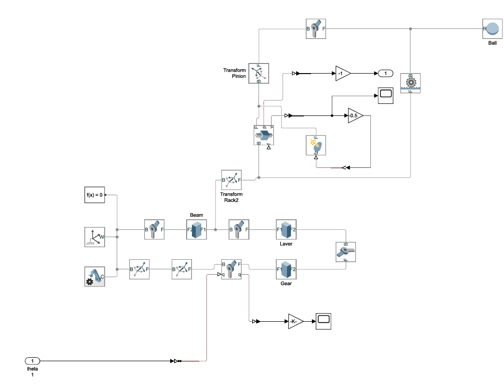
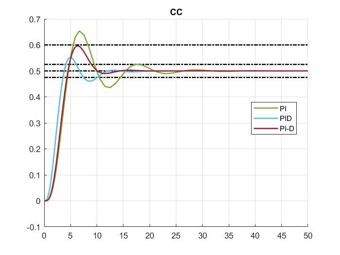
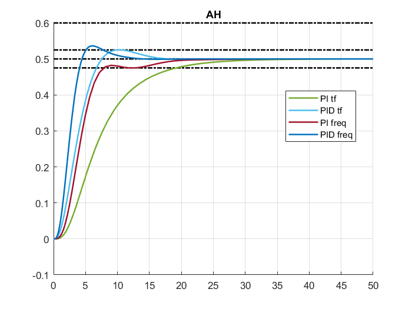
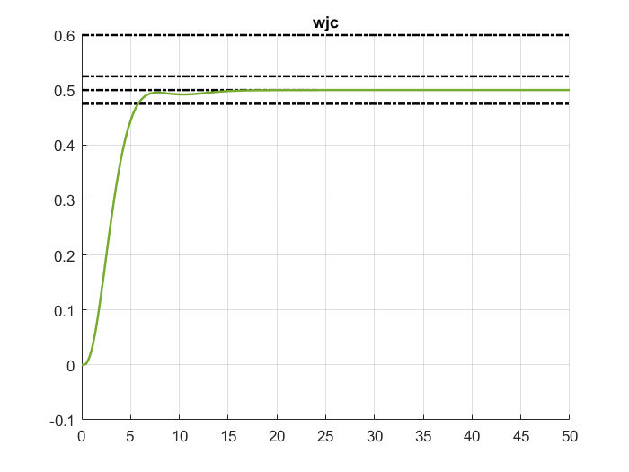

# Ball and Beam: PID Tuning Rules Benchmark

A comparative study of classical and optimal PID tuning methods applied to a **ball-and-beam** system, implemented in MATLAB/Simulink. The plant is identified from a physical (Simscape Multibody) model, reduced to a first-order-plus-dead-time (FOPDT) approximation, and then controlled with PI, PID and PI-D structures tuned by eight rule families. All designs are evaluated in closed loop on the same setpoint step.

<p align="center">
  
</p>
<p align="center"><em>Simscape Multibody model of the ball-and-beam mechanism (rack-and-pinion, lever, gear, beam, ball).</em></p>

---

## Contents

- [Project overview](#project-overview)
- [Plant modelling and identification](#plant-modelling-and-identification)
- [Tuning methods compared](#tuning-methods-compared)
- [Results](#results)
- [Repository structure](#repository-structure)
- [How to run](#how-to-run)
- [Credits](#credits)

---

## Project overview

The workflow has four stages:

1. **Model**: a physical ball-and-beam model in Simscape Multibody (`model/ball_and_beam_model.slx`).
2. **Identify**: a transfer function from beam angle $\theta$ to ball position $R$ is fitted to simulated step data (`Control/System Identification/`).
3. **Stabilise and reduce**: the integrating plant is wrapped in an inner IMC-based loop so that the effective plant becomes $G_{\mathrm{est}}(s)=\dfrac{1}{(s+1)^4}$. This plant is approximated by first-order-plus-dead-time (FOPDT) models, which are the basis for all tuning rules.
4. **Tune and compare**: PI / PID / PI-D controllers are designed with each method, simulated in `Control.slx` with a setpoint step of $0.5$ over $50$ s, and compared.

The FOPDT model used for tuning has the form

$$
G_{\mathrm{FOPDT}}(s)=\frac{K\,e^{-Ls}}{Ts+1}
$$

---

## Plant modelling and identification

**Identification** (`Control/System Identification/System_Identification.mlx`): input/output data (3001 samples, `dt = 0.01 s`, 30 s) is collected from the Simscape model and fitted with `tfest` (2 poles, 0 zeros, free delay). The identified model is

$$
\displaystyle G(s)=\frac{0.3494\,e^{-0.02s}}{s^{2}+0.2381s+4.6\times10^{-13}}
$$

That is, a double-integrator-like plant (one pole at the origin, one near $s=-0.24$) with a very small delay. It is consistent with the nominal model

$$
\displaystyle \frac{R(s)}{\theta(s)}=\frac{0.36}{s^{2}+0.24s}
$$

used in the control files. The fitted model and data are stored in `System_model.mat`.

**Plant used for design** (`Control/PID Control/System_define.m`): the servo and the beam transfer functions

$$
\frac{\theta(s)}{V(s)}=\frac{0.0274}{0.003228\,s^{2}+0.003508\,s},
\qquad
\frac{R(s)}{\theta(s)}=\frac{0.36}{s^{2}+0.24\,s}
$$

are combined (with gear ratio $0.2$ and gain $0.5$) into the plant $G(s)$. An IMC stabiliser is then built as

$$
Q(s)=\frac{1}{G(s)\,(s+1)^{4}},
\qquad
K_{\mathrm{IMC}}(s)=\frac{Q(s)}{1-Q(s)\,G(s)}
$$

so that the stabilised inner loop behaves as

$$
G_{\mathrm{est}}(s)=\frac{1}{(s+1)^{4}}
$$

This is the plant seen by the outer PID loop.

**FOPDT approximations of $G_{\mathrm{est}}$** (computed in `Task3_code.m`):

| Method | Function | $K$ | $L$ (s) | $T$ (s) |
|---|---|---|---|---|
| Step-response / moment based | `get_fod(Gest,1)` | $1$ | $2.00$ | $2.00$ |
| Frequency-response based | `get_fod(Gest,0)` | $1$ | $1.82$ | $3.87$ |
| H2-optimal model reduction | `opt_app` | (compared in the plot below) | | |

The ultimate gain and period of $G_{\mathrm{est}}$ are $K_c=4$ and $T_c=2\pi\ \mathrm{s}$. The step-response-based FOPDT model (`G_step`) is used by the time-domain rules, and the pair $(K_c,\,T_c)$ by the frequency-domain rules.

<p align="center">
  
</p>
<p align="center"><em>Step responses of G<sub>est</sub> and its FOPDT approximations.</em></p>

---

## Tuning methods compared

Each method is implemented as a MATLAB function in `Control/PID Control/`. Controller structure codes used throughout: `2` = PI, `3` = PID, `4` = PI-D (derivative in the feedback path). The PID controller uses a filtered derivative with $N=10$:

$$
G_c(s)=K_p\left(1+\frac{1}{T_i\,s}+\frac{T_d\,s}{1+T_d\,s/N}\right)
$$

| Method | File | Basis | Variants evaluated |
|---|---|---|---|
| Ziegler–Nichols | `ziegler_nic.m` | Step response $(K,L,T)$ and frequency response $(K_c,T_c)$ | PI, PID, PI-D |
| Refined Ziegler–Nichols | `rziegler_nic.m` | Step + frequency data, setpoint weighting $\beta$ | PI with weighting |
| Chien–Hrones–Reswick (CHR) | `chr_pid.m` | Step response | $0\%$ and $20\%$ overshoot, PI / PID |
| Cohen–Coon | `cohen_pid.m` | Step response, two parameter sets (CC, "CC revisited") | PI, PID, PI-D |
| Åström–Hägglund | `astrom_hagglund.m` | Step response and frequency response | PI, PID |
| WJC | `wjcpid.m` | Step response | PID |
| Optimum PID | `Optimum.m` | Minimisation of ISE / ISTE / IST$^2$E (tabulated formulas) for step-response and frequency-response data | PI, PID, PI-D |

Supporting files: `get_fod.m` and `tf_derv.m` (FOPDT fitting), `opt_app.m` and `opt_fun.m` (H2-optimal model reduction with `fminsearch`), `Task3_code.m` (main script), `System_define.m` (plant and stabiliser).

---

## Results

All plots show the closed-loop response to a setpoint step of $0.5$. The dash-dotted guides mark the setpoint ($0.5$), the $\pm5\%$ band ($0.475$ / $0.525$) and the $20\%$ overshoot level ($0.6$).

### Final comparison

The best controller of each family is compared below.

<p align="center">
  
</p>

| Controller | $K_p$ | $T_i$ (s) | $T_d$ (s) | Observed behaviour |
|---|---|---|---|---|
| **WJC PID** (best) | $0.946$ | $3.00$ | $0.667$ | Fast, smooth, essentially no overshoot |
| CHR PID ($20\%$ overshoot design) | $0.95$ | $2.80$ | $0.94$ | Comparable to WJC, essentially no overshoot |
| Optimum PID (ISTE, setpoint) | $1.042$ | $2.67$ | $0.77$ | Fastest rise, small overshoot (peak $\approx 0.52$) |
| Åström–Hägglund PID | $0.65$ | $2.18$ | $0.77$ | Slowest rise, peak $\approx 0.525$ near $t=10$ s |

**WJC PID was selected as the best controller** (see `Task3_code.m` and the video below).

> Parameters are computed analytically from the FOPDT model $K=1,\ L=2,\ T=2$ using the formulas in the corresponding files; the "observed behaviour" column is read from the simulation plot.

🎬 **Simulation video of the best controller:** [`results/video/Best_Controller.mp4`](results/video/Best_Controller.mp4)

### Per-method results

<table>
  <tr>
    <td align="center"><br><sub><b>Ziegler–Nichols</b>, step-response data</sub></td>
    <td align="center"><br><sub><b>Ziegler–Nichols</b>, frequency data</sub></td>
  </tr>
  <tr>
    <td align="center"><br><sub><b>Refined Ziegler–Nichols</b></sub></td>
    <td align="center"><br><sub><b>CHR</b>, 0% overshoot</sub></td>
  </tr>
  <tr>
    <td align="center"><br><sub><b>CHR</b>, 20% overshoot</sub></td>
    <td align="center"><br><sub><b>Cohen–Coon</b></sub></td>
  </tr>
  <tr>
    <td align="center"><br><sub><b>Cohen–Coon</b> (revisited parameter set)</sub></td>
    <td align="center"><br><sub><b>Åström–Hägglund</b> (PI/PID, step and frequency data)</sub></td>
  </tr>
  <tr>
    <td align="center"><br><sub><b>WJC</b> PID</sub></td>
    <td align="center"><br><sub><b>Optimum PID</b> (ISE / ISTE / IST<sup>2</sup>E), step-response data</sub></td>
  </tr>
  <tr>
    <td align="center"><br><sub><b>Optimum PID</b>, frequency data</sub></td>
    <td></td>
  </tr>
</table>

### Key observations

- **Frequency-based tuning is aggressive on this plant.** Ziegler–Nichols, Cohen–Coon (revisited) and Optimum PID designs based on $(K_c,\,T_c)$ produce oscillatory responses; the Cohen–Coon (revisited) PI response is almost undamped.
- **Step-response-based tuning is much better behaved.** The FOPDT model $K=1,\ L=2,\ T=2$ gives smooth responses for CHR, Åström–Hägglund, WJC and Optimum PID.
- **Derivative action helps.** PID and PI-D variants generally rise faster and settle sooner than PI.
- **Refined Ziegler–Nichols and WJC** give overshoot-free responses in the simulations.
- The **Optimum PID** results show the usual trade-off between criteria: all three (ISE, ISTE, IST$^2$E) settle in similar time with small overshoot.

---

## Repository structure

```
Ball and Beam/
├── model/
│   └── ball_and_beam_model.slx        # Simscape Multibody physical model
├── Control/
│   ├── System Identification/
│   │   ├── System_Identification.mlx  # Data collection, tfest, validation
│   │   └── System_model.mat           # Identified model / data
│   └── PID Control/
│       ├── Task3_code.m               # Main script: runs every method and comparison
│       ├── System_define.m            # Plant, IMC stabiliser, Gest = 1/(s+1)^4
│       ├── Control.slx                # Closed-loop Simulink test bench
│       ├── get_fod.m, tf_derv.m       # FOPDT fitting
│       ├── opt_app.m, opt_fun.m       # H2-optimal model reduction
│       ├── ziegler_nic.m, rziegler_nic.m
│       ├── chr_pid.m, cohen_pid.m
│       ├── astrom_hagglund.m, wjcpid.m
│       └── Optimum.m                  # ISE / ISTE / IST2E optimum PID
├── results/
│   ├── plots/                         # Response plots for every method
│   └── video/Best_Controller.mp4      # Simulation of the best controller
└── docs/
    ├── model_simulink_view.jpeg
    ├── System Identification.png
    └── ball_and_beam_system.jpeg
```

---

## How to run

**Requirements:** MATLAB with Simulink and Control System Toolbox. Simscape Multibody is needed only to open or simulate the physical model and to run the system identification.

1. Open MATLAB and set `Control/PID Control/` as the current folder.
2. Run `Task3_code.m`. It calls `System_define.m`, estimates the FOPDT models, tunes every controller, simulates each one in `Control.slx` (variables `Gc` and `H` are passed through the base workspace) and produces figures 1 to 13.
3. To repeat the identification, open `Control/System Identification/System_Identification.mlx` (it expects the logged `scope` data from `model/ball_and_beam_model.slx`; the identified model is also saved in `System_model.mat`).

`Control.slx` contains the inner stabilised loop built from transfer functions; a variant using the Simscape model ("internal loop real system") is included but commented out.

---

## Credits

- `Optimum.m` was prepared by Erfan Etesami (Sharif University of Technology, Dec 2020), implementing the optimum-setting formulas from the standard PID tuning tables.
- Tuning rules follow the classical literature: Ziegler–Nichols, Chien–Hrones–Reswick, Cohen–Coon and Åström–Hägglund.
